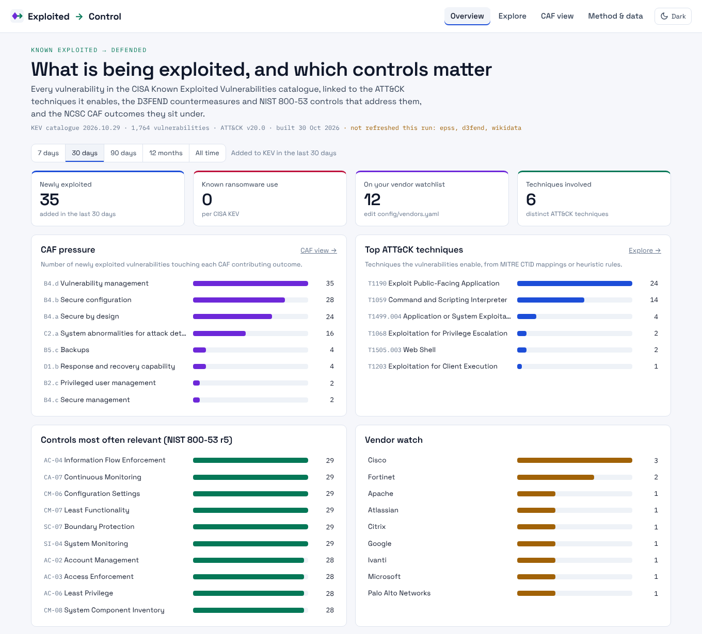

# Exploited Vulnerabilities Dashboard

**Exploited vulnerabilities mapped to countermeasures and controls.**

Exploited → Control takes every vulnerability in the CISA Known Exploited Vulnerabilities (KEV) catalogue and links it to:

- the **ATT&CK techniques** it enables
- the **D3FEND countermeasures** and **NIST SP 800-53** controls that address those techniques
- the **NCSC Cyber Assessment Framework (CAF)** contributing outcomes they sit under

It also adds **EPSS** exploitation probability and **Wikidata** vendor identities. Everything is published as open data, including JSON-LD.



## How it works

```
CISA KEV ──► CWE ──► CAPEC (context)
   │
   ├──► ATT&CK technique ── MITRE CTID mapping (direct)
   │                       └ heuristic rule (labelled, reviewable)
   │          │
   │          ├──► D3FEND countermeasures
   │          ├──► NIST 800-53 r5 controls (CTID)
   │          └──► NCSC CAF outcomes (config/caf-mapping.yaml)
   │
   ├──► EPSS score
   └──► vendor ──► Wikidata QID ──► Linked Open Data Cloud
```

- A **GitHub Action** runs twice a day. It downloads the sources, joins them and commits static files to `public/data/`.
- **Vercel** redeploys on that commit. Nothing is queried when someone loads a page, so a source outage never breaks the site.
- Each source has fallbacks and optional sources degrade gracefully. If one fails, the last good data stays and the page flags it (`meta.json` → `sources`).
- D3FEND and Wikidata lookups are **cached** in `data/cache/`, so a normal run makes only a handful of requests to them.

## Pages

| Route | What it shows |
|---|---|
| `/` | Headline counts, CAF pressure, top techniques, relevant controls, vendor watch, latest additions |
| `/explore/` | Filter by window, vendor, CAF outcome, technique, mapping source, ransomware and watchlist. Shows the full chain per CVE. URL state is shareable. |
| `/caf/` | Every CAF outcome with its exploitation pressure, top techniques and countermeasures |
| `/about/` | Method, per-source status for the latest build, coverage, data downloads |
| `/embed/` | A compact widget for iframing into another dashboard |

## Open data

| File | Contents |
|---|---|
| `/data/dataset.json` | Everything the UI uses |
| `/data/graph.jsonld` | JSON-LD using canonical CVE, CWE, CAPEC, ATT&CK, D3FEND and Wikidata IRIs |
| `/data/kev-enriched.csv` | One row per CVE (formula-injection safe) |
| `/data/meta.json` | Build time, source versions, coverage, warnings |

CORS is open on `/data/*`, so other dashboards can read the files directly.

## Run locally

```bash
npm ci
npm run data      # fetch sources and build public/data (about 30–60 s)
npm run dev       # http://localhost:3000
npm run build     # static export to out/
```

Requires Node 20 or later.

## Deploy (GitHub + Vercel)

1. Push this repo to GitHub (it lives at `jontever/cyber-dashboard`). Keep the folder structure: `app/`, `components/`, `config/`, `scripts/` and `.github/` must stay as folders.
2. In the repo **Settings → Actions → General**, allow *Read and write permissions* for workflows so the refresh job can commit data.
3. In **Settings → Variables** (GitHub) and **Environment Variables** (Vercel), set `SITE_URL` to your production URL, for example `https://e2c.cyberassure.uk`. It is used as the JSON-LD base IRI and for social-card URLs.
4. In Vercel, **Add New → Project**, import the repo and keep the defaults. `vercel.json` sets the build and the security headers.
5. Run **Actions → Refresh data → Run workflow** once to do the first full build, including EPSS, D3FEND and Wikidata.
6. Optionally, add a custom domain in Vercel.

## Embedding in another dashboard

```html
<iframe src="https://YOUR-SITE/embed/" width="100%" height="520" style="border:0" title="Exploited to Control"></iframe>
```

The widget is light by default. Use `/embed/?theme=dark` to match a dark dashboard.

Framing is blocked everywhere except `/embed/`. That route allows only the origins listed in `vercel.json` (`frame-ancestors`), which currently include cyberteam.uk. Edit the list to suit.

## Theme

The site opens in a light theme. A toggle in the header switches to dark, and the choice is saved in the browser (`localStorage`).
A `?theme=dark` or `?theme=light` URL parameter overrides it for that visit.

## Configuration

| File | Purpose |
|---|---|
| `config/sources.yaml` | Source URLs, fallbacks, cache ages and request budgets |
| `config/technique-rules.yaml` | Heuristic KEV → ATT&CK rules for CVEs that CTID has not mapped |
| `config/caf-mapping.yaml` | ATT&CK tactic and D3FEND tactic → CAF outcome mapping |
| `config/vendors.yaml` | Wikidata QID overrides, and the vendor watchlist |

## Coverage and caveats

- **Direct mappings** come from MITRE CTID's KEV mapping set, which lags the live catalogue. Newer CVEs use **heuristic rules** based on the vulnerability type and product. Each rule-based mapping is labelled and names the rule that produced it.
- **CAF mappings are a starter heuristic.** They are not NCSC guidance. Verify outcome codes against the CAF v4.0 text before relying on them, and improve them by pull request.
- **CAPEC is context only.** CAPEC's links to ATT&CK describe related patterns, not the exploitation itself, so they are not used to infer techniques.
- This is a prioritisation aid, **not threat intelligence**. Check vendor advisories before acting.

## Data sources and terms

| Source | Terms |
|---|---|
| [CISA KEV](https://www.cisa.gov/known-exploited-vulnerabilities-catalog) | US Government work |
| [FIRST EPSS](https://www.first.org/epss/) | See FIRST's usage guidance |
| [MITRE ATT&CK](https://attack.mitre.org/resources/legal-and-branding/terms-of-use/), [CAPEC](https://capec.mitre.org/about/termsofuse.html), [D3FEND](https://d3fend.mitre.org/) | MITRE terms of use |
| [CTID Mappings Explorer](https://ctid.mitre.org/projects/mappings-explorer/) | See its repository licence |
| [Wikidata](https://www.wikidata.org/) | CC0 |

Check each source's terms before you redistribute derived data.

## Security

- Static site, with no server-side code or secrets at runtime.
- Strict CSP, HSTS, `nosniff`, a locked-down Permissions-Policy and `frame-ancestors 'none'` (except `/embed/`).
- Workflows use least-privilege `permissions`. Dependabot covers npm packages and Actions.
- Consider pinning Actions to commit SHAs.

## Brand assets

- `app/icon.svg`, `app/favicon.ico` and `app/apple-icon.png`: the favicon set, picked up automatically by Next.js.
- `app/opengraph-image.png` and `app/twitter-image.png` (1200×630): the social preview card. Next.js adds the `og:` and `twitter:` tags.
- The source for the preview card is `docs/brand/og.html`. Render it at 1200×630 in any headless browser to regenerate it.

Social cards need absolute URLs, so set `SITE_URL` in Vercel (**Settings → Environment Variables**) to your production domain. Without it,
the build falls back to Vercel's production URL.

## Author

Built by [Jonathan Silvester](https://www.linkedin.com/in/jonsilvester).

## Licence

MIT for the code and configuration. Derived data follows its sources' terms.
